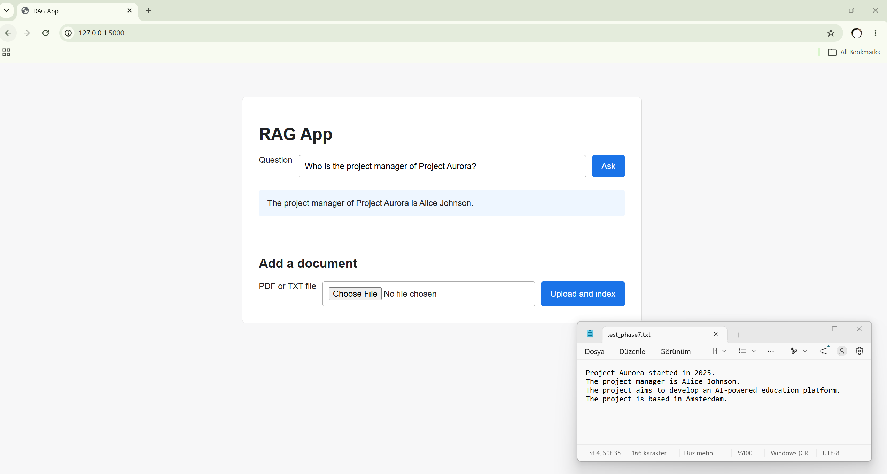

# RAG App — Document-Based AI Assistant

A simple Retrieval-Augmented Generation (RAG) application built with **Python, Flask, OpenAI API, and ChromaDB**.

I built this project to understand the end-to-end RAG workflow and explore how LLMs can generate answers using information retrieved from external documents.

## Features

- Upload PDF and TXT documents through a Flask web interface
- Automatically chunk and index uploaded documents
- Generate embeddings using OpenAI's `text-embedding-3-small`
- Store and retrieve relevant document chunks with ChromaDB
- Generate document-grounded answers using `gpt-4.1-mini`
- Detect duplicate uploads and handle errors

## Demo



*Example: The application retrieves information from a sample document to answer a question about Project Aurora.*

## How It Works

**Document → Chunking → Embeddings → ChromaDB → Semantic Retrieval → LLM → Answer**

1. Documents are processed, chunked, and stored as embeddings in ChromaDB.
2. User questions are matched with relevant document chunks.
3. Retrieved context is passed to the LLM to generate an answer.

## Getting Started

```bash
git clone https://github.com/Gizemgoker/RAG-app.git
cd RAG-app
python -m venv .venv
```

Activate the virtual environment (Windows PowerShell):

```powershell
.\.venv\Scripts\Activate.ps1
```

Install dependencies:

```bash
pip install -r requirements.txt
```

Create a `.env` file with your OpenAI API key:

```env
OPENAI_API_KEY